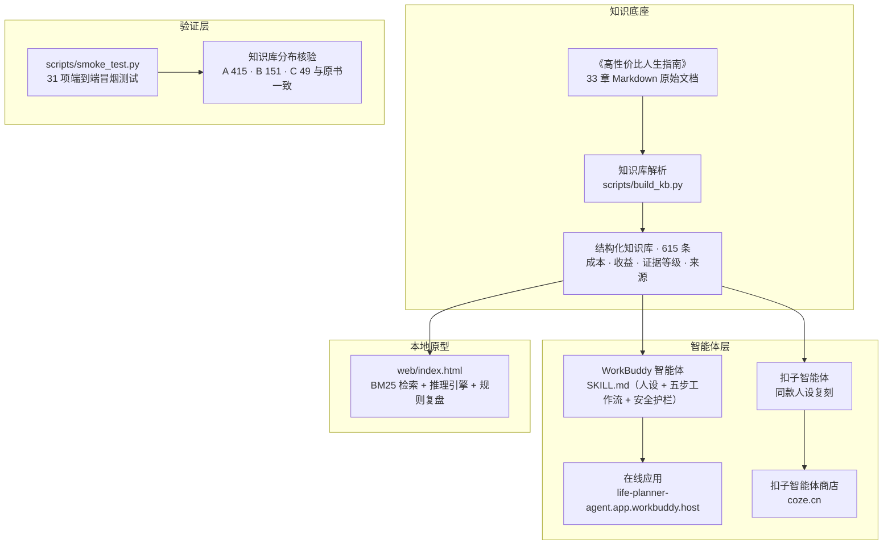
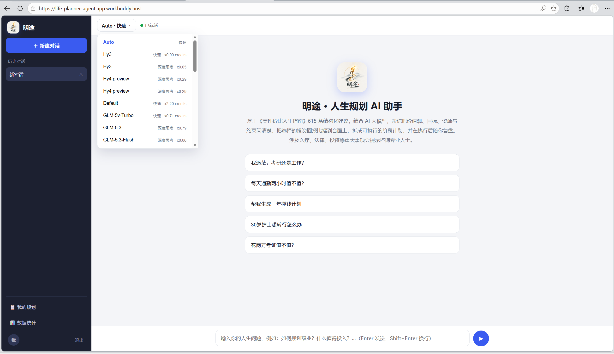
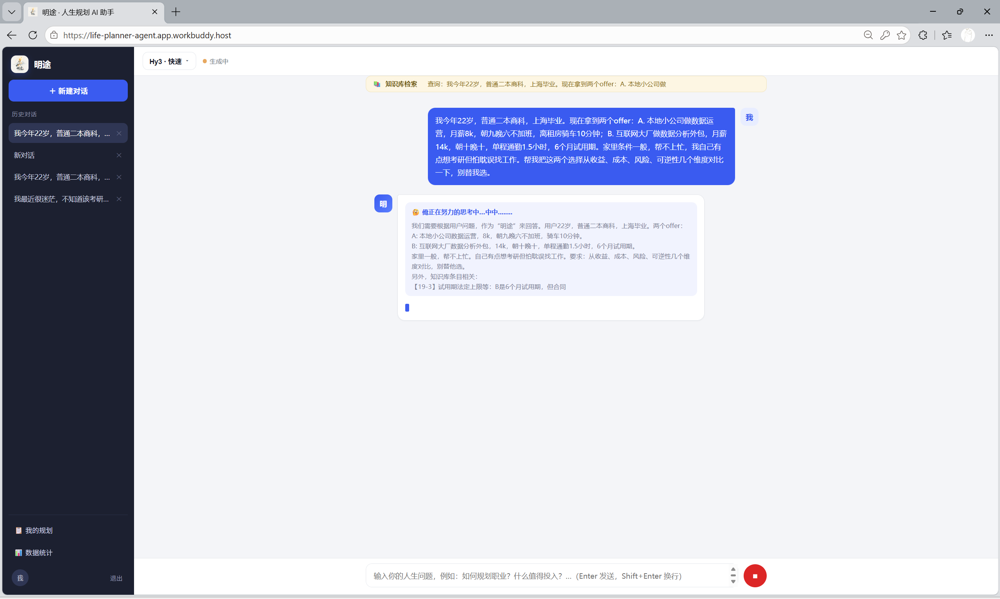
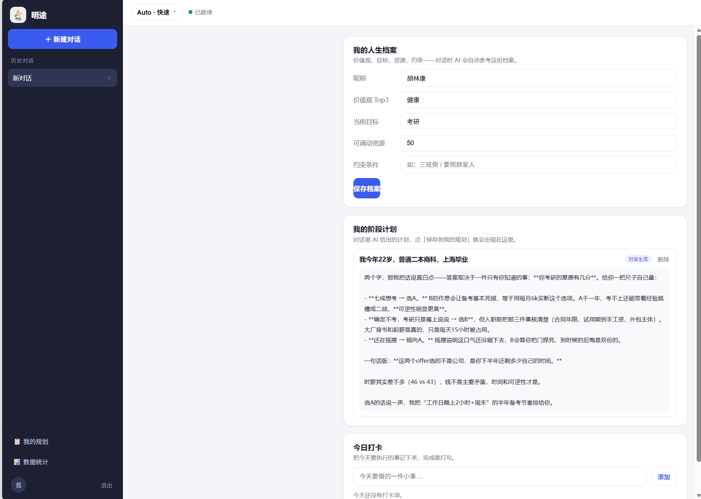
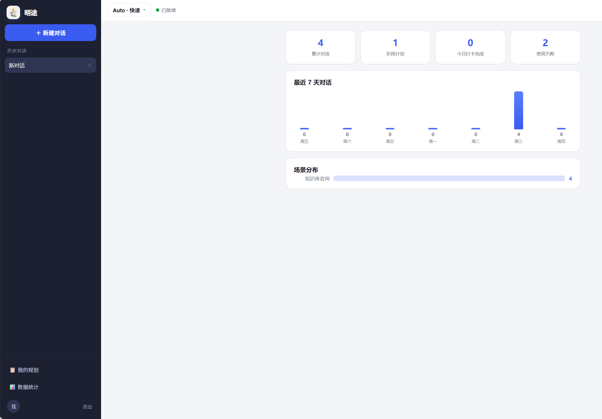
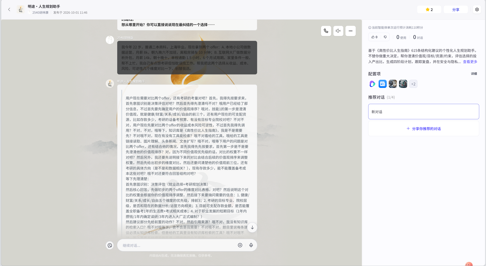
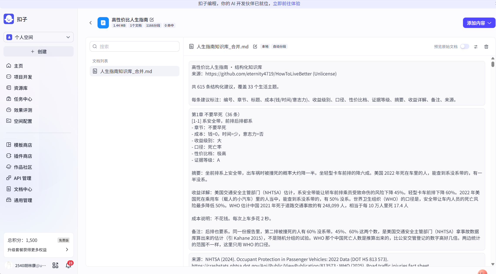

<div align="center">


# Summary of Intelligent Body School — 「明途」个性化人生规划 AI 助手

> **《大数据应用场景项目实训》项目** · 大数据智能体应用方向
> 
> Author：Hulinkang　　Instructor：퇴 함　|　2026 年 10 月

**用最少的钱、时间和精力，把每个人生选择的投入与产出摆到台面上**

[](https://life-planner-agent.app.workbuddy.host/)
[](https://www.coze.cn/store/agent/7690965999021522980?bot_id=true)
[](#5-知识库与数据)
[](#6-验证与测试)
[](#7-技术栈)

</div>

---

## English Executive Summary

**MingTu (明途)** is a personalized life-planning AI assistant built as the capstone project of the *Big Data Application Scenario Training* course. It does not make decisions for the user — it puts the costs and benefits of every choice on the table.

- **Knowledge base**: parsed the open-source manual *HowToLiveBetter* (Unlicense) into **615 structured, evidence-graded recommendations** (Evidence A/B/C: 415/151/49), keeping cost, benefit, evidence level, and source for every item.
- **Agent**: the persona and a **5-step workflow** (clarify values → evaluate ROI → generate a 4-phase plan → track & review → safety guardrails) are defined as a Skill on the WorkBuddy platform and replicated on Coze (扣子). Both are **published as live, publicly accessible apps**.
- **Online app**: cloud-hosted with email authentication, persistent storage, and usage statistics; row-level security policies enabled on all four data tables.
- **Retrieval**: Chinese BM25 retrieval recalls relevant items from the KB and injects them, together with the user profile, into the LLM prompt — every answer is traceable to a numbered source.
- **Validation**: KB parse distribution matches the official source exactly; **31/31 smoke tests and cloud pipeline checks passed**.

Author: **Hulinkang**

---

## 目录

1. [项目简介](#1-项目简介)
2. [核心能力](#2-核心能力)
3. [系统架构](#3-系统架构)
4. [在线演示](#4-在线演示)
5. [知识库与数据](#5-知识库与数据)
6. [验证与测试](#6-验证与测试)
7. [技术栈](#7-技术栈)
8. [目录结构](#8-目录结构)
9. [本地运行](#9-本地运行)
10. [项目角色与贡献](#10-项目角色与贡献)
11. [数据来源与许可](#11-数据来源与许可)

---

## 1. 项目简介

**明途**是一款面向大学生与初入职场的**个性化人生规划 AI 助手**。它不替用户做重大人生决定，而是做一面"结构化的镜子"——帮用户看清自己的价值观、看清每个选择的代价与回报、看清可执行的路径。

系统的知识底座来自开源手册《高性价比人生指南》（HowToLiveBetter），从原书 33 章中解析出 **615 条结构化建议**，逐条保留成本、收益、证据等级与来源四类字段。智能体的人设与五步工作流以 Skill 形式定义在 WorkBuddy 平台上，同一份提示词在扣子（Coze）平台复刻出同款智能体，并均发布为公开可访问的在线应用。

对话时，系统先用中文 BM25 从知识库召回相关条目，连同用户档案注入大模型提示词，使每一次回答都能溯源到具体条目编号；数据层四张表全部启用行级安全策略，用户数据不上传、本地优先。

## 2. 核心能力

| # | 能力 | 说明 |
|---|------|------|
| 1 | **自我盘点** | 澄清价值观排序（健康/财富/关系/成长/自由）、SMART 目标、资源与约束清单，形成用户档案 |
| 2 | **证据化咨询** | 意图识别 + BM25 检索 + 结构化回答，每条结论标注条目编号、章节、证据等级（A/B/C）与来源 |
| 3 | **决策罗盘** | 将纠结的选择拆为 2–4 个方案，按成本（钱/时间/意志力）× 收益（级别 × 口径）表格化对比投入产出比 |
| 4 | **四阶段路线图** | 自动生成 0–30 / 31–90 / 91–180 / 181–365 天阶段计划，每个任务标注知识库条目编号 |
| 5 | **执行看板** | 任务打卡 + 周复盘 + 完成率评级（优秀 >80% / 良好 60–80% / 待改进 <60%）与自动调整建议 |
| 6 | **多维知识检索** | 全文检索 + 按章节 / 证据等级 / 性价比 / 口径筛选（615 条全量结构化） |
| 7 | **安全护栏** | 危机干预（心理援助热线）、急症（120 急救指引）、法律风险、未成年人保护四类拦截，优先级高于一切建议 |

## 3. 系统架构



## 4. 在线演示

| 平台 | 名称 | 链接 |
|------|------|------|
| **WorkBuddy 在线应用** | 明途 · 人生规划 AI 助手 | <https://life-planner-agent.app.workbuddy.host/> |
| **扣子（Coze）智能体** | 明途-人生规划 AI 助手 | <https://www.coze.cn/store/agent/7690965999021522980?bot_id=true> |
| **本地原型** | 单页应用（双击即开） | `src/web/index.html` |

### 应用主界面（WorkBuddy 在线应用）



### 对话与知识库检索



### 我的规划与数据统计

　

### 扣子智能体

　

## 5. 知识库与数据

知识库来自《高性价比人生指南》33 个主题章节，覆盖健康、精力、时间、金钱、法律、婚恋、创业、紧急处置、住房、慢性病、育儿、工作、出国、技能、看病、身后事等生活全场景，解析为 615 条结构化条目：

| 维度 | 分布 |
|------|------|
| **总条目** | 615 条 |
| **证据等级** | A 级 415 · B 级 151 · C 级 49 |
| **性价比** | 极高 104 · 高 279 · 一般 232 |
| **收益口径** | 死亡率 204 · 金钱 230 · 时间 74 · 自由 107 |
| **争议条目 / 待办标记** | 63 / 32 |

每条目固定字段：编号、章节、标题、成本（钱/时间/意志力）、收益级别与口径、性价比档、证据等级、摘要、收益详解、来源（期刊论文 / 官方文件链接）、备注。

> 解析结果与原书官方公布的分布逐项一致，保证知识库构建的严谨性与可追溯性（见 [验证与测试](#6-验证与测试)）。

## 6. 验证与测试

| 验证项 | 方法 | 结果 |
|--------|------|------|
| 知识库解析正确性 | 解析后统计分布与原书官方公布值比对 | 615 条，A/B/C = 415/151/49，完全一致 |
| 端到端冒烟测试 | `scripts/smoke_test.py`（Playwright + Chromium） | **31 / 31 通过** |
| 云端链路验证 | 在线应用注册 / 登录 / 对话 / 数据统计全链路 | 通过 |
| 安全护栏用例 | 危机、急症、法律三类输入触发测试 | 正确拦截并给出规范指引 |

## 7. 技术栈

| 层级 | 技术 |
|------|------|
| 前端 | 原生 HTML5 / CSS3 / ES6（无构建依赖，`file://` 协议可离线运行） |
| 检索与推理 | 中文 2-gram + BM25 + 场景路由 + 规则引擎（`engine.js`） |
| 知识库构建 | Python 3 + 正则解析（`build_kb.py`） |
| 智能体平台 | WorkBuddy Agent（Skill 定义 + 云服务）、扣子 Coze（同款复刻） |
| 测试 | Playwright + Chromium（`smoke_test.py`，31 项） |
| 报告生成 | python-docx（`report_docx.py`） |
| 视频生成 | Playwright 截图 + edge-tts / Windows SAPI + imageio-ffmpeg（`demo_video.py`） |

## 8. 目录结构

```text
Summary-of-Intelligent-Body-School/
├── README.md                        # 本文件（项目总览）
├── LICENSE.md                       # 许可声明
├── docs/                            # 课程报告与论文
│   ├── 《大数据应用场景项目实训》课程报告_Hulinkang.docx
│   ├── 大数据应用场景项目实训课程论文_Hulinkang.pdf
│   └── 在线链接.md
├── src/                             # 项目源码
│   ├── web/                         # 前端单页应用（双击即可运行）
│   │   ├── index.html               # 应用入口
│   │   └── assets/
│   │       ├── css/                 # 样式
│   │       ├── js/                  # kb.js(615条知识库) · engine.js(检索推理) · agent.js · cloud.js
│   │       ├── img/                 # 品牌素材
│   │       └── video/               # 开场动画
│   ├── knowledge/                   # 知识库
│   │   ├── 人生指南知识库_合并.md    # 615 条合并版（1.5MB）
│   │   └── raw/                     # 33 章原始 Markdown（可追溯）
│   └── scripts/                     # 构建 / 测试 / 报告 / 智能体自动化脚本
│       ├── build_kb.py              # 知识库解析构建
│       ├── smoke_test.py            # 31 项端到端冒烟测试
│       ├── report_docx.py           # 课程报告 Word 生成
│       ├── demo_video.py            # 演示视频生成
│       └── coze_*.py                # 扣子智能体创建 / 配置 / 发布自动化
├── agent/                           # 智能体定义与配置
│   ├── workbuddy/                   # WorkBuddy 智能体（SKILL.md + 记忆模板）
│   └── coze/                        # 扣子智能体（人设与回复逻辑、搭建指南）
├── screenshots/                     # 界面截图（workbuddy / coze / 在线应用）
└── media/                           # 品牌素材（logo、开场视频）
```

## 9. 本地运行

### 方式 1：双击运行（推荐）

直接用浏览器打开 `src/web/index.html`。知识库以静态脚本嵌入（`kb.js`），不依赖网络请求，`file://` 协议下即可运行，断网可用。

### 方式 2：本地服务器

```bash
cd src/web
python -m http.server 8000
# 浏览器访问 http://localhost:8000/
```

### 方式 3：从源码重新构建

```bash
cd src
python scripts/build_kb.py       # 重新解析知识库 → web/assets/js/kb.js
python scripts/smoke_test.py     # 运行 31 项端到端测试
python scripts/report_docx.py    # 重新生成课程报告
python scripts/demo_video.py     # 重新生成演示视频
```

## 10. 项目角色与贡献

本项目中独立完成的工作：

1. **知识库工程**：编写解析脚本将 33 章 Markdown 结构化为 615 条带四类字段（成本/收益/证据等级/来源）的 JSON 知识库，并与原书官方分布逐项核验一致。
2. **检索与推理引擎**：实现中文 2-gram + BM25 检索、场景路由、投入产出比评估、四阶段计划生成与复盘诊断规则引擎。
3. **智能体设计**：编写"明途"人设与五步工作流、安全护栏、记忆策略，在 WorkBuddy 与扣子双平台落地并发布为公开应用。
4. **在线应用接入**：接入云服务的邮箱认证、数据持久化与使用统计能力，数据表启用行级安全策略。
5. **质量保障**：搭建 31 项端到端冒烟测试，验证知识库分布、对话检索、安全护栏与云端链路。
6. **交付物**：课程报告（Word/PDF）、演示视频、可运行原型。

## 11. 数据来源与许可

- **知识库内容**：来源于开源项目《高性价比人生指南》（[github.com/eternity4719/HowToLiveBetter](https://github.com/eternity4719/HowToLiveBetter)），以 **Unlicense** 许可发布（公有领域）。本项目仅做结构化解析与重新组织，所有条目保留原文出处与来源链接。
- **本项目自有代码与文档**：版权归作者所有，仅用于展示与求职用途；许可细节见 [LICENSE.md](LICENSE.md)。
- 本系统为课程作业原型，所有推理在用户本机浏览器完成，不上传个人数据；系统不替代医生、律师、会计，不替用户做重大人生决定。
